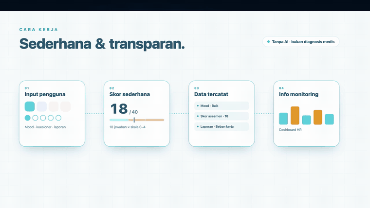

# 🌊 Featured Project: [Rivora](https://github.com/Nuzzy32/Rivora)

**Rivora** shows flood conditions per location for residents across Indonesia: water depth, last update, and who reported it. Citizen reports are verified per city/regency, alongside BMKG weather forecasts and emergency contacts.
*Kenali kondisi. Siapkan langkah.*

   

---

# 🧠 Featured Project: [Riskala Lite](https://github.com/Nuzzy32/RiskalaLite)

**Riskala Lite** helps companies look after workplace stress. Employees log a daily mood check-in, take a short stress assessment, and file complaint reports; HR follows up from one dashboard. Simple and transparent scoring, no AI and no medical diagnosis.
*Pantau. Peduli. Dukung.*

    

---

# 💫 About Me:
🔭 I’m currently working on a new project called Literasiku, Riskala Lite 👯 I’m looking to collaborate on  🌱 I’m currently learning flutter framework, html + css, React, MySql Etc.

## 🌐 Socials:
   

# 💻 Tech Stack:
                  
# 📊 GitHub Stats:
 
 

## 🏆 GitHub Trophies

### ✍️ Random Dev Quote

---

  ## 💰 You can help me by Donating
   

  
<!-- Proudly created with GPRM ( https://gprm.itsvg.in ) -->
